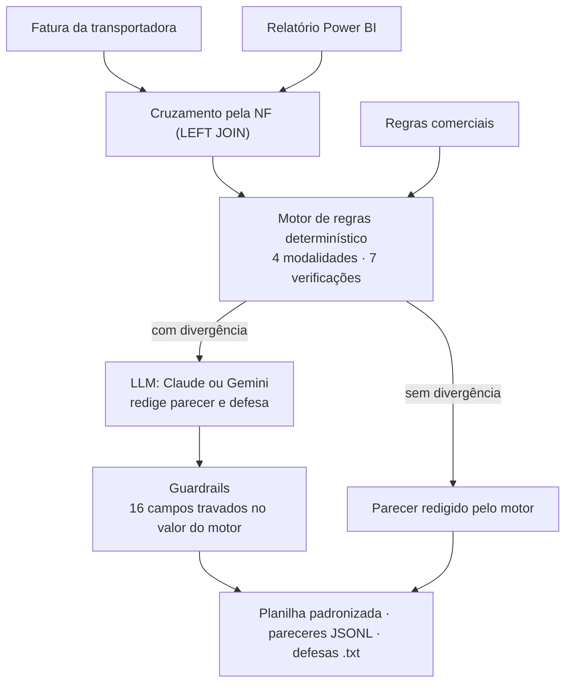

# Auditoria de Fretes com IA

Painel web e agente em Python que auditam faturas de transportadoras. Cada CT-e é cruzado com a base interna do SAP (publicada no Power BI), o frete é recalculado pela regra comercial do contrato e cada glosa sai com uma defesa técnica pronta para o Financeiro.

**Demonstração online:** [amaro-bit.github.io/auditoria-fretes-ia](https://amaro-bit.github.io/auditoria-fretes-ia/) (dados sintéticos, transportadoras fictícias)

> O código calcula, a IA redige e o código confere. Nenhum número vem do LLM.

## O problema

Auditar frete é responder, para cada CT-e, "quanto deveria ter custado?". A resposta exige cruzar três fontes e aplicar a regra do contrato, que muda de uma transportadora para outra.

| Fonte | O que traz |
| --- | --- |
| Fatura da transportadora | CT-e, valor cobrado, peso taxado, frete-peso, ad valorem, GRIS, ICMS e serviço faturado |
| Relatório do Power BI (base do SAP) | NF, UF de origem e destino, peso real, volume, valor da mercadoria, frete previsto e serviço contratado |
| Regras comerciais | Tabelas, calculadoras, seletor de serviço e cotações spot registradas no WhatsApp |

## As quatro regras comerciais

| Modalidade | Exemplo | Como o valor devido é calculado | O que o motor detecta |
| --- | --- | --- | --- |
| Tabela combinada + ICMS | Transportadora Alfa | Rota × faixa do peso taxável na tabela, com ICMS por dentro | Faixa de peso acima da correta; rota fora da tabela |
| Calculadora em massa | Beta Cargas e Gama Logística | Frete-peso (maior entre peso real e cubado × tarifa) + ad valorem + GRIS | Peso cubado inflado; ad valorem ou GRIS acima do contrato |
| Seletor de serviço (aéreo) | Delta Express | Peso taxável × tarifa do serviço contratado | Premium ou Expresso faturado no lugar de Standard ou E-commerce |
| Cotação spot (WhatsApp) | Épsilon Rodoviário | Valor acordado, com ICMS incluso ou por fora | Cobrança acima da cotação; ICMS somado por fora; cotação sem registro |

Valem para todas as modalidades: duplicidade de CT-e, NF ausente no Power BI, alíquota de ICMS (7% ou 12% no rodoviário, 4% no aéreo) e divergência entre o frete previsto no Power BI e a regra.

## Arquitetura



O mesmo motor existe nas duas pontas. No `index.html`, em JavaScript, ele roda no navegador e no GitHub Pages, sem servidor. No `auditor_ia.py`, em Python, ele roda em lote e é o único lugar que chama o LLM: no navegador, a chave de API ficaria exposta.

## Resultados nas bases de demonstração

| Base | CT-es | Aprovados | Divergência crítica | Em análise | Glosa recomendada |
| --- | --- | --- | --- | --- | --- |
| Simulação do painel | 74 | 39 | 25 | 10 | R$ 7.586,24 (6,9% do faturado) |
| `dados_exemplo/` | 21 | 9 | 8 | 4 | R$ 1.950,18 (5,4% do faturado) |

## Como usar

### Painel

Abra o `index.html` no navegador, ou o link da demonstração, e siga quatro passos:

1. Clique em **Carregar Base Simulada (Fatura + Power BI)** ou arraste as suas planilhas CSV para o card 1.
2. Clique em **Executar Agente de Auditoria IA** e acompanhe a aba **Resumo da Auditoria** ou o **Log Técnico (IA)**.
3. Clique em uma linha da tabela para ver o cruzamento das fontes, a memória de cálculo e a defesa técnica.
4. Exporte a **Planilha Padronizada (.CSV)** ou as **defesas (.txt)**.

O painel precisa de internet só para carregar o Tailwind, o Chart.js e o Lucide pelos CDNs. As planilhas são processadas no próprio navegador e nenhum dado é enviado para fora.

### Agente em Python

```bash
pip install -r requirements.txt
python auditor_ia.py --fatura dados_exemplo/fatura_transportadora.csv \
                     --power-bi dados_exemplo/relatorio_power_bi.csv \
                     --cotacoes dados_exemplo/cotacoes_whatsapp.csv
```

Sem `--provedor`, o modo é `offline`: o próprio motor redige os pareceres, sem internet e sem custo. A saída no terminal:

```text
════════════════════════════════════════════════════════════════════════
AUDITORIA DE FRETES · fatura × Power BI × regra comercial
════════════════════════════════════════════════════════════════════════
Fontes: 21 CT-es da fatura (5 transportadoras, R$ 36.204,35) · 21 notas do Power BI · 5 cotações WhatsApp
Cruzamento pela NF: 20 cruzados · 1 sem NF no BI · 2 notas do BI sem cobrança
Resultado: 9 aprovados · 8 com divergência crítica · 4 em análise
Glosa recomendada: R$ 1.950,18 (5,4% do faturado) · 4 CT-es pedem revisão humana

Por transportadora:
                                        CT-es  Divergências       Cobrado        Glosa
Transportadora      Regra                                                             
Épsilon Rodoviário  Cotação spot            5             5  R$ 20.446,90  R$ 1.030,23
Transportadora Alfa Tabela + ICMS           1             1   R$ 1.090,91    R$ 444,32
Delta Express       Seletor de serviço      4             2   R$ 1.347,90    R$ 321,78
Beta Cargas         Calculadora             6             3   R$ 5.842,29    R$ 153,85
Gama Logística      Calculadora             5             1   R$ 7.476,35      R$ 0,00

Maiores glosas:
  NF 184233 · Épsilon Rodoviário · Cobrança acima da cotação acordada · R$ 552,27
  NF 184254 · Transportadora Alfa · Cobrança acima da faixa de peso · R$ 444,32
  NF 184266 · Épsilon Rodoviário · Cobrança acima da cotação acordada · R$ 402,69
  NF 184261 · Delta Express · Serviço faturado acima do contratado · R$ 195,88
  NF 184222 · Delta Express · Cobrança em duplicidade · R$ 125,90
```

Para que um LLM redija as divergências, defina a chave numa variável de ambiente e escolha o provedor:

```bash
export ANTHROPIC_API_KEY="sua-chave"     # Gemini: export GEMINI_API_KEY="sua-chave"
python auditor_ia.py --fatura dados_exemplo/fatura_transportadora.csv \
                     --power-bi dados_exemplo/relatorio_power_bi.csv \
                     --provedor claude --limite-llm 3 --salvar-payloads
```

No Windows, use `$env:ANTHROPIC_API_KEY="sua-chave"` (PowerShell) ou `set ANTHROPIC_API_KEY=sua-chave` (Prompt de Comando).

| Opção | O que faz |
| --- | --- |
| `--fatura` | CSV da fatura (obrigatório); aceita também a planilha padronizada exportada pelo painel |
| `--power-bi` | CSV do relatório do Power BI |
| `--cotacoes` | CSV das cotações spot (opcional) |
| `--provedor` | `offline` (padrão), `claude` ou `gemini` |
| `--modelo` | Modelo do provedor; padrão `claude-sonnet-5-5` ou `gemini-flash-latest` |
| `--limite-llm` | Máximo de chamadas ao LLM por execução (padrão: 30) |
| `--salvar-payloads` | Grava em `saida/payloads_llm.jsonl` o que foi enviado ao LLM |
| `--prompt` | Arquivo do system prompt (padrão: `system_prompt_agente.md`) |
| `--saida` | Pasta dos arquivos gerados (padrão: `saida/`) |

Os arquivos gerados em `saida/`:

- `auditoria_fretes_padronizada.csv`: 45 colunas, separador `;` e vírgula decimal. Abre direto no Excel e pode ser reaberto no painel.
- `pareceres_auditoria.jsonl`: um parecer JSON por linha, no formato `parecer_auditoria_v3`.
- `defesas_tecnicas.txt`: as defesas técnicas, com as glosas primeiro e as maiores antes.

## Formato das planilhas

Cada planilha é reconhecida pelas colunas, não pelo nome do arquivo, e cada coluna aceita vários nomes.

| Planilha | Colunas obrigatórias | Colunas usadas pelas regras |
| --- | --- | --- |
| Fatura | `nf`, `transportadora`, `valor_cobrado` | `numero_cte`, `fatura`, `data_emissao`, `peso_taxado_kg`, `frete_peso`, `ad_valorem`, `gris`, `aliquota_icms`, `servico_faturado` |
| Power BI | `nf`, `frete_previsto_bi` | `transportadora`, `uf_origem`, `uf_destino`, `peso_real_kg`, `volume_m3`, `valor_mercadoria`, `servico_contratado` |
| Cotações | `nf`, `valor_acordado` | `cotacao_id`, `transportadora`, `icms_incluso`, `data_cotacao` |

Os números podem vir no formato brasileiro (1.234,56) ou no americano (1234.56). O separador pode ser `;` ou `,`, e a codificação, UTF-8 ou o ANSI do Excel. Os modelos estão em `dados_exemplo/` e também podem ser baixados no painel.

## Decisões de projeto

- **Os números não vêm do LLM.** O motor é determinístico e o LLM recebe os valores prontos. Se a IA alterar algum dos 16 campos travados, `validar_resposta()` mantém o valor do motor e registra a divergência.
- **Só as divergências vão para o LLM**, até o teto de `--limite-llm`. CT-es aprovados e falhas de API ficam com o parecer do motor.
- **Prompt versionado em arquivo.** O `system_prompt_agente.md` usa role prompting, raciocínio em etapas, JSON Schema e três exemplos few-shot gerados pelo próprio motor. No Claude, ele vai com cache de prompt.
- **Uma dependência só.** Além do Pandas, tudo vem da biblioteca padrão. As APIs são chamadas com `urllib`, com nova tentativa e espera crescente em erros 429, 5xx e 529.
- **Segurança.** Chaves ficam só em variáveis de ambiente; o painel escapa todo texto contra XSS; as exportações são protegidas contra CSV injection.
- **Extensível.** Cada modalidade é uma estratégia (`MOTOR` no Python, `Motor` no JavaScript): uma regra nova pede duas funções e uma linha de registro.

## Como foi validado

Os testes abaixo foram feitos durante o desenvolvimento:

- **Paridade JavaScript × Python:** com as mesmas planilhas (95 CT-es), as duas pontas deram os mesmos status, valores e textos. A planilha padronizada saiu idêntica célula a célula.
- **Cenários injetados:** cada tipo de erro simulado gerou o achado esperado, sem falso positivo.
- **Entradas problemáticas:** CSV em ANSI, arquivo vazio, linhas incompletas e arquivo trocado geram mensagens claras.
- **Guardrails:** um LLM simulado devolveu resposta adulterada, JSON inválido e erro de API, e um servidor HTTP local imitou as APIs do Claude e do Gemini.
- **Layout:** a altura da página do painel ficou constante durante a execução em 1440, 1366 e 390 px de largura.

## Estrutura do repositório

```text
auditoria-fretes-ia/
├── index.html                 # painel: ingestão, agente, tabela, gráficos e exportação
├── auditor_ia.py              # agente em Python: Pandas, motor de regras, LLM e guardrails
├── system_prompt_agente.md    # system prompt do agente, lido pelo auditor_ia.py
├── dados_exemplo/             # fatura, relatório do Power BI e cotações de exemplo
├── requirements.txt
└── .gitignore
```

## Próximos passos

- Cruzar pela chave de acesso da NF-e (44 dígitos) em vez do número da NF, que se repete entre emissores.
- Levar as regras para um arquivo de configuração lido pelas duas pontas, acabando com a duplicação entre JavaScript e Python.
- Transformar os testes de paridade e de cenários numa suíte pytest rodando no GitHub Actions.
- Ler as bases direto do SAP e do Power BI, em vez de CSV.

## Tecnologias

Painel: HTML, TailwindCSS, JavaScript, Chart.js e Lucide. Agente: Python e Pandas, com as APIs do Claude e do Gemini. Testado com Python 3.12 e Pandas 3.0.

## Aviso

Todos os dados, contratos, notas fiscais e transportadoras deste repositório são fictícios. As regras de negócio reproduzem a rotina real de auditoria do autor; os valores, não.

Autor: [@Amaro-bit](https://github.com/Amaro-bit)
